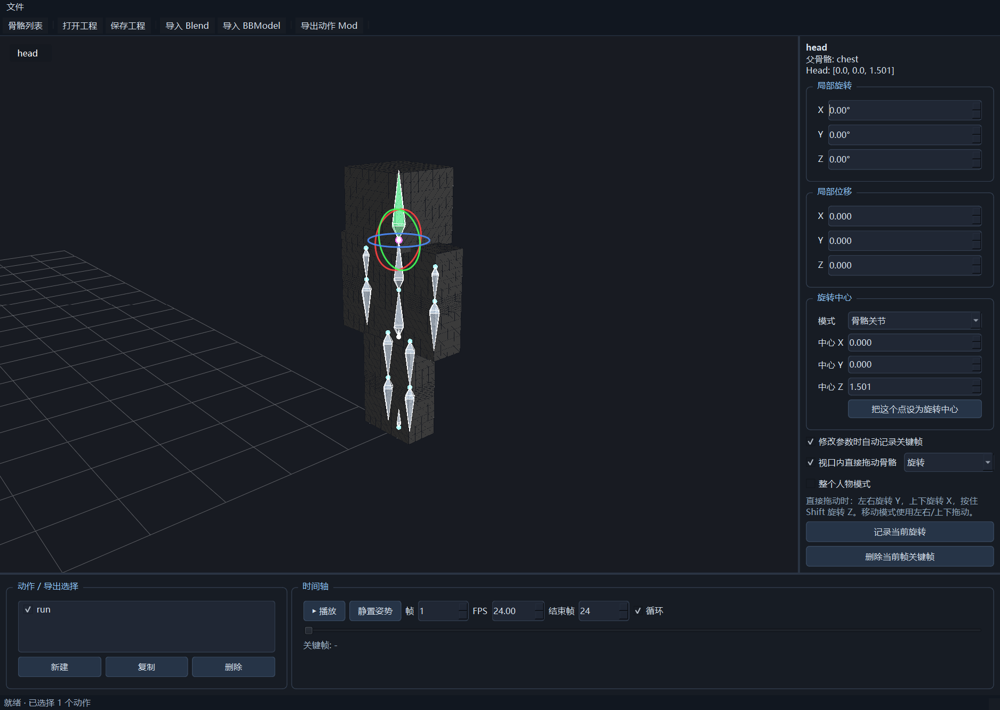

# Minecraft Action Mod Studio

面向 Minecraft Java 版动作模组的可视化桌面工具：从 Blockbench 导入方块模型 → 搭建骨骼 → 绑定方块 → 关键帧调动作 → 导出一个可直接编译的 Forge 动作 Mod。

Windows 桌面程序，界面基于 PySide6 + pyqtgraph 实时 3D 视口，不需要在 Blender 或 Blockbench 内部操作。



## 功能

### 导入
- 直接导入 Blockbench `.bbmodel`：解析方块、贴图与 UV、嵌套 group 变换、骨骼层级和原有动画。
- 导入时可选择「只导入模型」：默认不带入模型自带的骨骼和动作，所有方块保持未绑定，方便自己重新搭建骨骼。
- 直接导入 `.blend`：调用本机 Blender 4.0 作为后台转换器提取骨骼、网格权重和动作。

### 骨骼与绑定
- 新建骨骼 / 新建子骨骼 / 重命名 / 修改父骨骼 / 编辑关节 Head 与末端 Tail / 删除。
- 部件绑定：Ctrl 多选方块后「绑定到当前骨骼」或「解除绑定」，「自动绑定到最近骨骼」按距离批量分配。
- 视口内可直接点选方块或骨骼；未绑定的方块会提示先绑定。

### 视口操纵器（Blender 风格）
- 选中骨骼后出现 Gizmo：
  - `R` 旋转模式：红(X)/绿(Y)/蓝(Z) 三色圆环，拖动圆环只绕对应世界轴旋转。
  - `V` 移动模式：红/绿/蓝三色箭头，拖动箭头沿对应世界轴平移。
  - 鼠标移到圆环/箭头上会变成手形，拖动实时写关键帧。
- 「视口内直接拖动骨骼」：左右拖动旋转 Y，上下拖动旋转 X，按住 Shift 左右拖动旋转 Z。
- 「整个人物模式」操作最上层根骨骼；「锁定当前骨骼」后点击其它对象不会切走。
- 旋转中心可选骨骼关节、整个人物中心或自定义 XYZ。

### 动作与关键帧
- 新建 / 复制 / 删除动作，设置 FPS、结束帧、循环。
- 修改旋转或位移自动记录关键帧（可关闭自动 K 帧改为手动记录）。
- 时间轴常驻面板，支持播放预览、逐帧查看。
- 未选中动作时第一次拖动会自动切换到第一个动作开始记录，不会出现「拖不动」。

### 工程与导出
- `.mcasproj` 工程文件保存完整模型、骨骼、绑定和全部动作。
- 导出 `Minecraft Forge 26.3 (66.0.9)` 的 `player_model` Mod，可多选动作一起构建，并可自动复制到测试实例的 `mods` 目录。

## 下载

在 [Releases](../../releases) 下载 `MinecraftActionModStudio-v0.6-win64.zip`，解压后双击 `MinecraftActionModStudio.exe` 即可运行（绿色免安装，Windows 10/11 64 位）。

## 从源码运行

```bash
pip install -r requirements.txt
python run_studio.py
```

依赖：PySide6 6.12、pyqtgraph 0.14、PyOpenGL 3.1、numpy 2.x。

## 打包

```bash
pyinstaller --noconfirm standalone_studio.spec
```

产物在 `dist/MinecraftActionModStudio/`。

## 环境要求

- 系统：Windows 10/11 64 位
- `.blend` 导入需要本机安装 Blender 4.0
- 导出 Mod 需要可用的 Forge 26.3 构建环境（Java）

## 快捷键

| 按键 | 功能 |
| --- | --- |
| 在视口按 `R` | 旋转模式（三色圆环） |
| 在视口按 `V` | 移动模式（三色箭头） |
| `Shift` + 左右拖动 | 直接拖动时转 Z 轴 |
| 鼠标中键 / 右键拖动 | 旋转、平移视图 |
| 滚轮 | 缩放视图 |

当前版本：**0.6**
