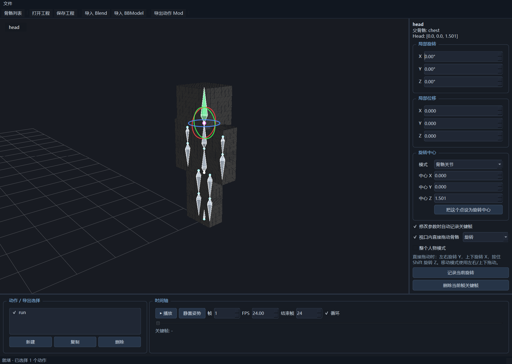

[中文](README.md) | **English**

# Minecraft Action Mod Studio

A desktop tool for creating Minecraft Java Edition action mods: import a Blockbench model, build a skeleton, bind cubes, keyframe the animation, and export a ready-to-compile Forge action mod.

Windows desktop application with a real-time 3D viewport built on PySide6 + pyqtgraph. You do all the work inside this tool — no need to open Blender or Blockbench.



## Features

### Import
- Import Blockbench `.bbmodel` directly: cubes, textures and UVs, nested group transforms, bone hierarchy and existing animations.
- Optional **model-only import**: by default the model's own bones and animations are not imported, and every cube stays unbound, so you can rig it yourself.
- Import `.blend` files by using a local Blender 4.0 installation as a background converter to extract bones, mesh weights and actions.

### Rigging
- Create bones / child bones, rename, change parent, edit joint Head and Tail positions, delete bones.
- Bind parts: Ctrl-select multiple cubes, then `Bind to Current Bone` or `Unbind`, or use `Auto Bind to Nearest Bone` to assign everything by distance.
- Click cubes or bones directly in the viewport. Unbound cubes show a hint telling you to bind them first.

### Viewport gizmos (Blender-style)
- After selecting a bone a gizmo appears:
  - `R` rotate mode: red (X) / green (Y) / blue (Z) rings. Dragging a ring rotates around that world axis only.
  - `V` move mode: red / green / blue arrows. Dragging an arrow translates along that world axis.
  - The cursor turns into a hand over a ring or arrow, and dragging writes keyframes in real time.
- `Drag bones in viewport`: horizontal drag rotates Y, vertical drag rotates X, hold Shift and drag horizontally to rotate Z.
- `Whole-body mode` drives the topmost root bone; `Lock current bone` keeps the selection fixed while you click other objects.
- Rotation pivot can be the bone joint, the whole character center, or a custom XYZ point.

### Animation
- Create, duplicate and delete actions; set FPS, end frame and looping.
- Changing rotation or location records a keyframe automatically (auto-key can be turned off for manual keying).
- Persistent timeline panel with playback preview and frame stepping.
- If no action is selected, the first drag automatically switches to the first action and starts keying — dragging never silently does nothing.

### Project and export
- `.mcasproj` project files store the full model, skeleton, bindings and all actions.
- Export a `Minecraft Forge 26.3 (66.0.9)` `player_model` mod. Multiple actions can be selected and built together, and the result can be copied straight into a test instance's `mods` folder.

## Download

Grab `MinecraftActionModStudio-v0.6-win64.zip` from [Releases](../../releases), extract it and double-click `MinecraftActionModStudio.exe` (portable, Windows 10/11 64-bit).

## Run from source

```bash
pip install -r requirements.txt
python run_studio.py
```

Dependencies: PySide6 6.12, pyqtgraph 0.14, PyOpenGL 3.1, numpy 2.x.

## Build

```bash
pyinstaller --noconfirm standalone_studio.spec
```

The output is placed in `dist/MinecraftActionModStudio/`.

## Requirements

- OS: Windows 10/11 64-bit
- `.blend` import requires Blender 4.0 installed locally
- Exporting a mod requires a working Forge 26.3 build environment (Java)

## Shortcuts

| Key | Action |
| --- | --- |
| `R` in viewport | Rotate mode (three colored rings) |
| `V` in viewport | Move mode (three colored arrows) |
| `Shift` + horizontal drag | Rotate Z axis while dragging directly |
| Middle / right mouse drag | Orbit or pan the view |
| Mouse wheel | Zoom |

Current version: **0.6**
